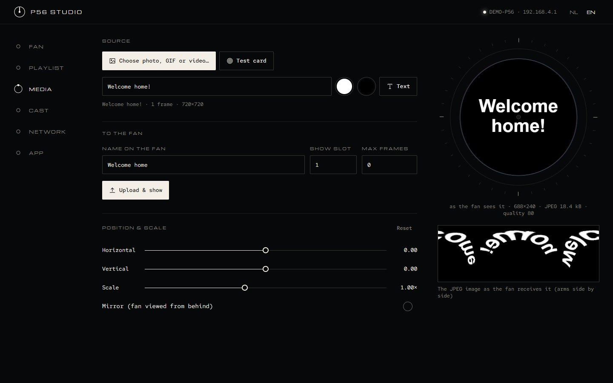
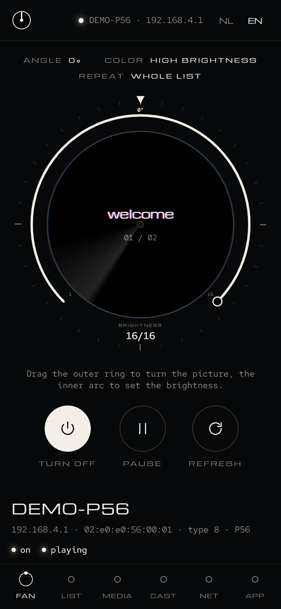
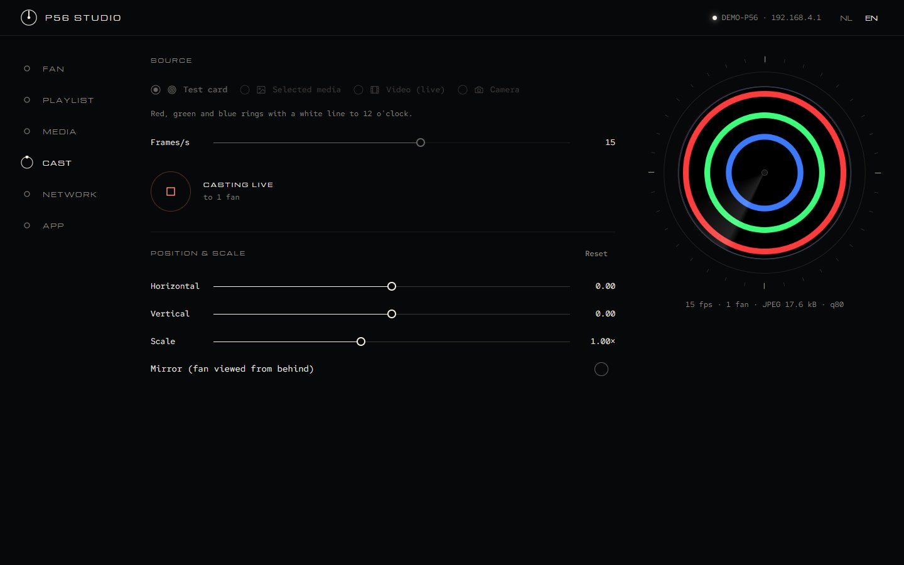
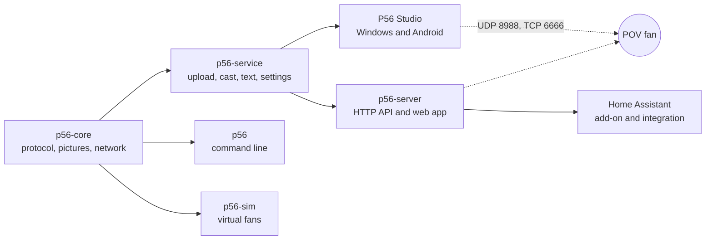

<div align="center">


# P56 Studio

**The open-source replacement for the Holoscope app.**<br>
Control P56 / Holoscope POV hologram fans from Windows, Android, the command line or Home Assistant.
Local, fast, no account, no cloud.

[](https://github.com/trackerr/p56-studio/actions/workflows/ci.yml)
[](https://github.com/trackerr/p56-studio/releases/latest)
[](https://github.com/trackerr/p56-studio/releases)


[](LICENSE)

[](https://github.com/trackerr/p56-studio/releases/latest)
[](https://github.com/trackerr/p56-studio/releases/latest)
[](https://github.com/trackerr/home-assistant-p56)


</div>

---

## Features

<table>
<tr>
<td width="50%" valign="top">

**Full control**<br>
The fan is drawn as a dial: drag the outer ring to turn the picture; brightness (16 steps) is the
slider below it. Plus power, play/pause, repeat, breathing light, autostart,
volume, rename, delete, format and factory reset.

**Upload anything**<br>
Photos, GIFs and video (decoded right in the app), or just type a **text**: it is word-wrapped
and sized to fit the round display.

**Live cast**<br>
Stream a test card, your media (photos, GIFs, videos), your **camera**, your **screen** or, in
Home Assistant, any **camera entity** to one or more fans at up to 25 fps, with nothing stored on the fan.

</td>
<td width="50%" valign="top">

**True preview**<br>
See exactly what the fan will show, both as the round picture and as the fan's own polar
layout, before you send it.

**Network setup**<br>
Rename the fan, change its hotspot, put it on your Wi-Fi (router mode).

**Home Assistant**<br>
An add-on and integration: text with icons and ready-made styles, notifications, camera
snapshots, GIFs and videos on the fan from your automations, and pictures drawn by AI (ComfyUI in
your house, or Google through Home Assistant). [Learn more →](https://github.com/trackerr/home-assistant-p56)

</td>
</tr>
</table>

## Screenshots

<table>
<tr>
<td width="62%"><br><sub><b>Media</b>: text, photo, GIF or video, with the round preview and the picture as the fan receives it</sub></td>
<td width="38%" rowspan="2" align="center"><br><sub>The same app on <b>Android</b></sub></td>
</tr>
<tr>
<td><br><sub><b>Cast</b>: a test card, your media, a video, the camera or the screen, live</sub></td>
</tr>
</table>

The look is called *Baan* (Dutch for orbit): everything is round, like the fan itself. See [docs/DESIGN.md](docs/DESIGN.md).

---

## Get started

Step by step for everyday use: **[user guide](docs/GUIDE.md)**.

### Windows

1. Download **`P56.Studio_…_x64-setup.exe`** from the [latest release](https://github.com/trackerr/p56-studio/releases/latest) and install it.
2. Connect the PC to the fan's Wi-Fi hotspot, or put the PC and the fan on the same router.
3. **Close Holoscope**: only one program can serve a fan at a time.
4. Start **P56 Studio**. Windows asks to open the firewall the first time: allow it for private networks.
5. The fan appears by itself.

> **Good to know:** a P56 has a 2.4 GHz Wi-Fi radio only (so use a 2.4 GHz network for router
> mode), and with an empty playlist it blinks four blue LEDs: keep one black picture on it.

### Android

1. Download **`P56-Studio-…-android.apk`** from the [latest release](https://github.com/trackerr/p56-studio/releases/latest) and open it (allow installing from your browser if asked).
2. Join the fan's Wi-Fi hotspot (or the same router) and open **P56 Studio**.

The app keeps using the fan's Wi-Fi even though it has no internet, and keeps the screen on while you cast.

### Home Assistant

Install the add-on and integration from **[trackerr/home-assistant-p56](https://github.com/trackerr/home-assistant-p56)**:
one-click install buttons, a sidebar panel with this app, and actions like `p56_pov.show_text`.

> **Fan not showing up?** Check that both devices are on the same network, that Holoscope is closed,
> and that the firewall allows UDP 8988 and TCP 6666. You can also enter the fan's IP in the **App** tab (*Fan IP, if you know it*).

---

## No fan? Use the simulator

`p56-sim` behaves exactly like a real fan on your network, so you can try everything without hardware.

```bash
p56-sim                      # one simulated P56
p56-sim --count 3            # three fans
```

Open P56 Studio and the simulated fan connects by itself. **http://localhost:8099/** shows what
it displays, its settings and any protocol errors.

## Command line

<details>
<summary><b>p56</b>: every feature from a terminal or script</summary>

```bash
p56 info                              # all fans with their status
p56 upload photo.jpg --slot 1         # also .gif, and video when ffmpeg is installed
p56 cast test --seconds 10            # live test card
p56 brightness 12
p56 angle -45
p56 name LivingRoom
p56 router MyWifi mypassword          # put the fan on your Wi-Fi
p56 --help
```

Options for all commands: `--target <fan-ip>:8988` (reach a fan directly), `--fan <n>` / `--all` (several fans), `--type <fan type>`, `--wait <seconds>`.
</details>

## Server

`p56-server` runs the same engine headless, with an HTTP API, live events and this web app:

```bash
p56-server --http-port 8765            # add --simulate for a virtual fan
```

Then open **http://localhost:8765/**. It powers the Home Assistant add-on; static Linux builds
(x86_64 and aarch64) are in every release.

It answers only this machine until you add `--lan`; protect that with `--api-token <token>`.
`--fan-allow <ip>` limits which addresses may connect as a fan. `--comfyui http://<pc>:8188`
makes AI pictures with [ComfyUI](https://www.comfy.org) and Qwen Image 2.1 on a computer in your
house (`--comfyui-size`, default 768); see the
[add-on documentation](ha/p56_pov_display/DOCS.md#ai-pictures).

One server can be the single controller of your fans while Home Assistant, browsers and P56
Studio on other phones and computers use it at the same time (App tab → *Control through a P56
server*): a fan keeps one connection, to the app or server it found.

<details>
<summary>API in short</summary>

| Request | What it does |
| --- | --- |
| `GET /api/state` | Connected fans, status and playlists |
| `POST /api/show` | Show text or a picture: `{"text": "Hello", "show_seconds": 30}` |
| `POST /api/call/<command>` | Any app command, e.g. `control` `{"id": 1, "action": "off"}` |
| `GET /api/events` | Live events (server-sent events) |
| `POST /api/call/show_ai` | An AI picture on the fan: `{"prompt": "a jellyfish", "show_seconds": 30}` |
| `GET /api/shown/<mac>` | PNG of what the fan was last sent (faded when it is no longer on it) |

Full reference: [add-on documentation](ha/p56_pov_display/DOCS.md#http-api-port-8765).
</details>

---

## Supported fans

| Fan types (as reported by the fan) | Status |
| --- | --- |
| **8** (P56), 1, 2, 3, 4, 5, 11, 14, 17 | ✅ Supported (JPEG picture format) |
| 6, 7, 12, 13, 15 | ⚠️ Sent in the older Holoscope.exe format; newer firmware may ignore it |
| others | ❌ Not implemented yet |

The protocol was worked out from the Holoscope app and is documented in
[PROTOCOL.md](PROTOCOL.md). Everything is tested against the built-in simulator.

## How it fits together



<details>
<summary>Repository layout</summary>

| Folder | What |
| --- | --- |
| [`crates/p56-core`](crates/p56-core) | Protocol, picture conversion (polar warp, JPEG), network link |
| [`crates/p56-service`](crates/p56-service) | Everything the apps do, behind one command API |
| [`app/`](app) | P56 Studio: Tauri 2 shell + React UI (`app/ui`, Radix primitives with its own design: [DESIGN.md](docs/DESIGN.md)) |
| [`crates/p56-cli`](crates/p56-cli) | `p56` command line |
| [`crates/p56-sim`](crates/p56-sim) | Simulated fans with a web view |
| [`crates/p56-server`](crates/p56-server) | Headless server for Home Assistant and other hosts |
| [`ha/`](ha) | Home Assistant add-on and integration — the source of [home-assistant-p56](https://github.com/trackerr/home-assistant-p56), which is published from this folder with `git subtree split --prefix ha` (make changes here, not there) |
| [`e2e/`](e2e), [`scripts/`](scripts) | End-to-end tests, gauntlet loop, Android build, README screenshots |
</details>

## Build and test

<details>
<summary>Build from source</summary>

Requirements: Rust (stable), Node 20 + pnpm; for Android the SDK/NDK (see `scripts/android.ps1`).

```bash
cargo build --release --workspace                 # p56, p56-sim, p56-server, P56 Studio
cd app/ui && pnpm install && pnpm run bundle      # after UI changes → app/src/index.html
cd app && npx tauri build                         # Windows installer
powershell -File scripts/android.ps1 build        # Android APK
```

Release signing of the APK reads `app/src-tauri/gen/android/keystore.properties` (not in git).
</details>

<details>
<summary>Run the tests</summary>

```bash
cargo test --workspace                            # unit, simulator, CLI and server tests
powershell -File scripts/gauntlet.ps1 -Rounds 20  # everything, repeated until something fails
node e2e/app-e2e.mjs                              # the real app against the simulator
cd ha && pytest                                   # Home Assistant integration against p56-server
```

GitHub Actions runs the Rust tests, the UI build and the Home Assistant tests on every push,
and builds all release files from a version tag.
</details>

---

<div align="center">

**MIT licensed** · Not affiliated with the maker of the fans or of Holoscope.<br>
The protocol was worked out for interoperability with hardware you own; no vendor code or binaries are included.

</div>
