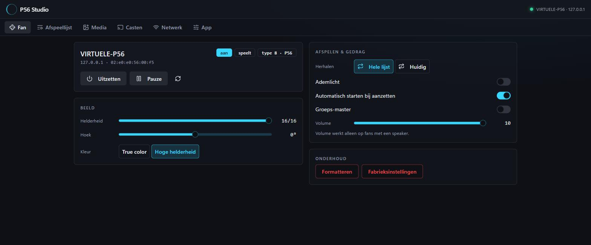

# Design: "Baan"

*Baan* is Dutch for orbit. A POV fan draws its picture in circles, so the app does too: the fan is a
dial, choices are orbits, the playlist is a row of discs. The aim is a look that belongs to this device
rather than a generic dashboard.



## Principles

- **Round where it means something.** The fan screen is one dial: the disc shows what is playing, the
  outer bezel is the picture angle (a real control); the brightness is a plain slider below the dial.
- **Light, not colour.** Near-black ground, one warm white for everything that is on or chosen. The
  only colour is a thin red/blue fringe around the disc, like the fan's RGB LEDs. Red text is kept for
  destructive actions.
- **Lines, not boxes.** Sections are separated by a hairline and a small wide-caps title. There are no cards,
  shadows, gradients or coloured badges.
- **Two typefaces.** Michroma (wide caps) for titles, labels and navigation; Red Hat Mono for
  everything you read or type. Both are bundled (`@fontsource`), so the app works offline.

## Tokens

Defined as CSS variables in [`app/ui/src/index.css`](../app/ui/src/index.css) and mapped in
[`tailwind.config.cjs`](../app/ui/tailwind.config.cjs).

| Token | Value | Use |
| --- | --- | --- |
| ground (`--background`) | `#060708` | page |
| card (`--card`) | `#0B0C0D` | dialogs, notifications |
| text (`--foreground`) | `#EDEAE4` | body text |
| light (`--primary`) | `#F4EFE6` | active, chosen, values, the main button |
| muted (`--muted-foreground`) | `#8E8A83` | labels, hints, inactive |
| hairline (`--border`) | `#1D1C1A` | section rules |
| line (`--input`) | `#3A3833` | control outlines |
| danger (`--destructive`) | `#FF8A7A` | format, reset, delete, errors |
| fringe | `#FF2D55`, `#2DFF8A`, `#3D7BFF` | only around the disc |

Corners are square (2 px) except for things that are round by nature (discs, round keys, switches).
Touch targets are at least 44 px.

## Components

All in [`app/ui/src/components`](../app/ui/src/components):

| Component | What |
| --- | --- |
| `Orbit` | The round view. With `brightness` / `angle` its rings become sliders (`role="slider"`; drag, arrow keys, Page Up/Down, Home/End). Without them it is the round preview (`RoundView`). |
| `DiscText` | Text on the disc with the hologram fringe. |
| `Choice` | One of a few options as orbits (radio group, arrow keys). |
| `Switch` | An empty ring when off, a lit planet in it when on. |
| `Section`, `Readout`, `Status`, `Notice` | Hairline sections, label/value pairs, status words with a dot, framed messages. |
| `icons.tsx` | The app's own line icons (24 px grid, 1.6 stroke), the P56 mark and the navigation orbit. |

The Radix primitives (dialog, select, slider, switch, tabs) stay underneath for keyboard and
screen-reader behaviour; only their look is our own.

## Layout

- **Desktop:** a header with the mark, fan picker and connection, a rail of orbits on the left, content up to 1180 px.
- **Phone:** the same header, a bar of six orbits at the bottom (short labels), one column.
- The app icon ([`app/app-icon.svg`](../app/app-icon.svg)) is the dial itself: bezel, brightness arc,
  disc with fringe, one blade at 12 o'clock.

## Screenshots

The README pictures come from the UI's browser demo mode (a simulated fan, no hardware):

```bash
pnpm --dir app/ui dev
node --experimental-websocket scripts/screenshots.mjs
```

The mockups that led to this design (four directions: Baan, Instrument, Lichtkrant, Affiche) were
made on a design canvas before any code was written.
