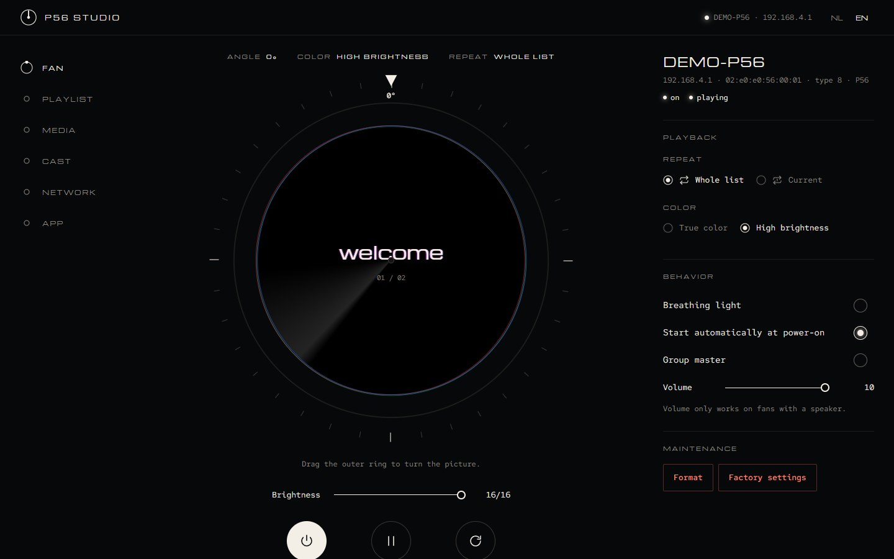
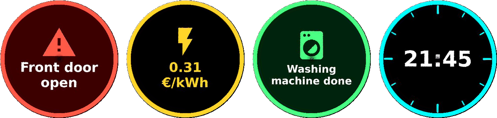

<div align="center">


# P56 POV Display for Home Assistant

**Put text, prices, notifications, camera snapshots and pictures on your Holoscope / P56
hologram fan, straight from Home Assistant. Local, no vendor app, no cloud.**

[](https://github.com/trackerr/home-assistant-p56/actions/workflows/validate.yml)
[](https://hacs.xyz/docs/faq/custom_repositories)

[](LICENSE)


</div>

---

## ✨ What you get

| | |
| --- | --- |
| 💡 **Control** | On/off and brightness as a light, play/pause, playlist, repeat, picture angle, colour mode |
| 📝 **Text** | A text field on your dashboard, or the `p56_pov.show_text` action, sized automatically to fit the round display |
| 🔔 **Notifications** | `notify.send_message` shows a message for 15 seconds, then the playlist resumes |
| 🎨 **Styles & icons** | Ready-made looks (alert, warning, info, success, price, clock) with a ring along the rim, any Home Assistant icon, and a text colour that follows a value (green → red) |
| 🖼️ **Pictures & animations** | `p56_pov.show_image` from a file, a URL, the media library or a camera snapshot; animated GIFs and videos play as animations |
| ✨ **AI pictures** | `p56_pov.show_ai` or the panel's Media tab: describe a picture and the AI you set up in Home Assistant (AI Task, e.g. Google Gemini) draws a still, a turning picture or an animation |
| 👀 **Preview** | An image entity that shows what the fan is displaying right now |
| 🖥️ **Web app** | The full P56 Studio app as a sidebar panel: upload photos, GIFs and video, cast live, change Wi-Fi |
| 🔌 **Self-contained** | Everything runs inside Home Assistant; the fans connect to it on your own network |

<p align="center"></p>

---

## 🚀 Installation

> 📖 After installing: the **[user guide](docs/GUIDE.md)** explains the panel, dashboards,
> automations, your cameras, and using your phone through Home Assistant.

You need **two parts**: the **add-on** (talks to the fan) and the **integration** (gives you the
entities and actions). Both are in this repository.

### Step 1 — Add-on

[](https://my.home-assistant.io/redirect/supervisor_add_addon_repository/?repository_url=https%3A%2F%2Fgithub.com%2Ftrackerr%2Fhome-assistant-p56)

1. Click the button above (or go to **Settings → Add-ons → Add-on store → ⋮ → Repositories**
   and add `https://github.com/trackerr/home-assistant-p56`).
2. Install **P56 POV Display** and press **Start**.
3. Optional: turn on **Show in sidebar** to get the **P56 POV** panel.

> 💡 No fan at hand? Turn on the **Virtual fan** option: a simulated fan connects and you can
> try everything.

### Step 2 — Integration

[](https://my.home-assistant.io/redirect/hacs_repository/?owner=trackerr&repository=home-assistant-p56&category=integration)

1. Click the button above (or in **HACS → ⋮ → Custom repositories** add this repository with type
   **Integration**).
2. Download **P56 POV Display** and **restart Home Assistant**.

<details>
<summary>Without HACS</summary>

Copy the folder `custom_components/p56_pov` to `/config/custom_components/` and restart Home Assistant.
</details>

### Step 3 — Connect

Go to **Settings → Devices & services**. Home Assistant shows **"P56 POV Display discovered"**:
click **Add**. Every fan that connects now appears as a device.

### Step 4 — Put the fan on your Wi-Fi (once)

A new fan starts as its own Wi-Fi hotspot, which Home Assistant can't reach. Connect a phone or
PC to that hotspot once, open [P56 Studio](https://github.com/trackerr/p56-studio/releases)
(or the vendor app), go to **Network → Router** and enter your Wi-Fi name and password.
From then on the fan joins your Wi-Fi and finds Home Assistant by itself.

---

## 🧩 Entities

For each fan (example names for a fan called *P56*):

| Entity | What it does |
| --- | --- |
| `light.p56` | Picture on/off and brightness |
| `switch.p56_playing` | Play / pause |
| `select.p56_file` | Choose what plays |
| `select.p56_repeat` | Repeat all files or one |
| `text.p56_text` | Type something, the fan shows it |
| `notify.p56_message` | Notifications, shown for a while |
| `image.p56_shown` | What Home Assistant last sent to the fan |
| `sensor.p56_playing_file`, `sensor.p56_files` | Current file, number of files |
| `number.p56_picture_angle`, `select.p56_colour_mode` | Settings |

Plus `sensor.p56_server_connected_fans` (0 means no fan is connected).

---

## 🛠️ Actions & examples

### Show text

```yaml
action: p56_pov.show_text
data:
  text: "{{ states('sensor.energy_price') }} €/kWh"
  color: "#ffc800"          # or [255, 200, 0], or a name: yellow, red, …
  show_seconds: 60          # remove again after a minute (0 = keep)
  name: energy              # the same name replaces the previous one
```

### Styles, icons and colours that follow a value

<p align="center"></p>

```yaml
action: p56_pov.show_text
data:
  text: "{{ states('sensor.energy_price') }} €/kWh"
  style: price                       # alert · warning · info · success · price · clock
  value: "{{ states('sensor.energy_price') }}"
  value_min: 0.20                    # green
  value_max: 0.35                    # red (yellow in between)
```

```yaml
action: p56_pov.show_text
data:
  text: Washing machine done
  style: success
  icon: mdi:washing-machine          # any icon from Home Assistant's icon picker
```

### Show a picture or an animation

```yaml
action: p56_pov.show_image
data:
  camera: camera.front_door   # or: path: /media/logo.gif  ·  url: https://…/clip.mp4  ·  media: (picker)
  show_seconds: 20
```

### Send a notification

```yaml
action: notify.send_message
target:
  entity_id: notify.p56_message
data:
  message: The washing machine is done
```

| Action | Fields |
| --- | --- |
| `p56_pov.show_text` | `text`, `style`, `icon`, `value` + `value_min` + `value_max`, `color`, `background`, `icon_color`, `ring`, `font_size`, `show_seconds`, `mode`, `name`, `device_id` |
| `p56_pov.show_image` | one of `path` / `url` / `camera` / `media` (pictures, GIFs, videos), plus `show_seconds`, `mode`, `name`, `fps`, `max_frames`, `scale`, `x_offset`, `y_offset`, `mirror`, `device_id` |
| `p56_pov.show_ai` | `prompt`, plus `kind` (`still` / `spin` / `anim`), `entity_id` (an AI Task; default the first that makes pictures), `show_seconds`, `mode`, `name`, `device_id` |
| `p56_pov.play_file` | `device_id` and `slot` or `name` |
| `p56_pov.delete_file` | `device_id` and `slot` or `name` |

`mode: upload` (default) stores the picture on the fan; `mode: cast` shows it live without
storing anything. Leave out `device_id` to use all fans.

More ready-to-use automations: [examples/automations.yaml](examples/automations.yaml).

---

## ❓ Questions & troubleshooting

<details>
<summary><b>No fan appears</b></summary>

- The fan must be on the **same network** as Home Assistant (router mode, not its own hotspot).
- Check the add-on log: it shows every fan that answers.
- Broadcast blocked or another subnet? Enter the fan's IP under the add-on option **Fan IP addresses**.
- Only one program can serve a fan at a time: close the vendor app and P56 Studio on other devices.
</details>

<details>
<summary><b>I used the old 1.x add-on</b></summary>

Uninstall the old local add-on and remove the old integration entry, then follow the steps above.
Old `rest_command`s that post to `http://localhost:8765/text` keep working.
</details>

<details>
<summary><b>Can other devices use the API?</b></summary>

Yes: port **8765** offers an HTTP API (`/api/show`, `/api/state`, live events) and the web app.
Turn off the add-on option **API reachable on the network** to allow only Home Assistant itself.
See the [add-on documentation](p56_pov_display/DOCS.md) for the full API.
</details>

<details>
<summary><b>Which fans work?</b></summary>

Fans that use the Holoscope app (P56 and relatives). The add-on runs on **amd64** and **aarch64**
(Raspberry Pi 4/5, most mini PCs).
</details>

---

## 🏗️ How it works

```
 fan ──TCP 6666──▶ add-on (p56-server) ◀── HTTP + live events ── integration p56_pov
  ▲   UDP 8988 discovery    │  port 8765: API + web app (sidebar panel)
  └─────────────────────────┘
```

The add-on is built on [**p56-studio**](https://github.com/trackerr/p56-studio), the same Rust core
as the Windows and Android apps that replace the vendor app.

<details>
<summary>Development</summary>

The integration tests start Home Assistant against a real p56-server with a virtual fan:

```bash
pip install pytest-homeassistant-custom-component
P56_SERVER=/path/to/p56-server pytest
```
</details>

## 📄 License

MIT. Not affiliated with the maker of the fans or the Holoscope app.
